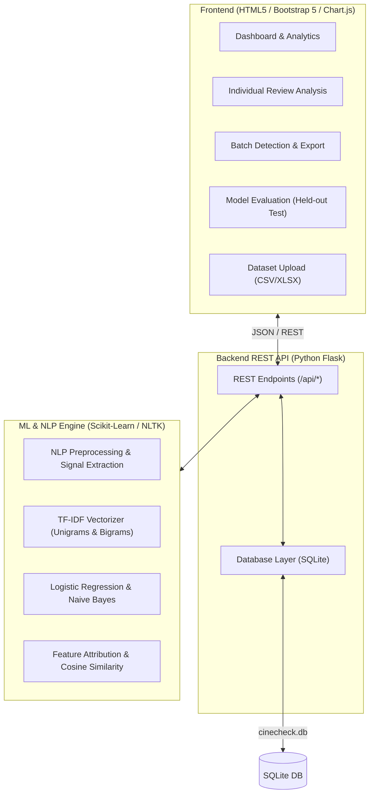

# CineCheck — Fake Movie Review Detection System

[](https://www.python.org/downloads/)
[](https://palletsprojects.com/p/flask/)
[](https://scikit-learn.org/)
[](https://sqlite.org/)
[]()

**CineCheck** is a full-stack academic Text and Web/Social Media Analytics (TWSMA) project engineered to detect potentially fake, promotional, or astroturfed movie reviews for theatrical releases listed on **BookMyShow** (January 1, 2025 to September 30, 2026).

---

## 1. System Architecture



---

## 2. Key Features

- **Empirical NLP Preprocessing Pipeline (TWSMA 1.1 & 2.1):**
  - Text normalization, URL and email removal
  - Elongated character compression (`"sooooo goooood"` &rarr; `"soo good"`)
  - Excessive punctuation compression (`"!!!!!!"` &rarr; `"!"`)
  - **Negation preservation:** Retains crucial contextual negations (`not`, `never`, `without`, `barely`, `hardly`)
  - Porter Stemming with robust fallback
  - Heuristic stylistic signal extraction (uppercase shouting ratio, promotional phrase matching)

- **Machine Learning Classification (TWSMA 2.1):**
  - Unigram + bigram TF-IDF vectorization (`ngram_range=(1, 2)`, sublinear term frequency)
  - Supervised training and comparison between **Logistic Regression** and **Multinomial Naive Bayes**
  - Model selection based on held-out test F1-macro validation
  - Calibrated outputs:
    - `Potentially Suspicious`
    - `More Likely Genuine`
    - `Insufficient Evidence` (for trivial or uninformative submissions)

- **Batch Analysis & Astroturfing Detection (TWSMA 6.1):**
  - Processes full CSV or XLSX datasets without GUI lockup
  - Pairwise TF-IDF cosine similarity clustering detects syndication / copy-paste bot clusters
  - Real-time search, filter by movie/category/rating, and pagination
  - One-click export of analyzed datasets to **CSV** and **Excel (.xlsx)**

- **Transparent Explainability (TWSMA 6.1):**
  - Mathematical decomposition of TF-IDF feature weights (positive suspicious vs negative genuine weights)
  - Color-coded feature chips displaying influential n-grams
  - Detection of rating vs sentiment dissonance (e.g. 1 star with blockbuster praise)

- **Bias Mitigation & Held-out Evaluation (TWSMA 2.3):**
  - 2x2 interactive Confusion Matrix (TN, FP, FN, TP)
  - Class-wise accuracy, precision, recall, and F1-score
  - Error rate disparity auditing across star rating sub-cohorts

- **Responsible AI Safeguards (TWSMA 6.2):**
  - Clear probabilistic disclaimers: no individual review is accused of fraud without human verification
  - Separation between ground-truth labels and model inference columns

---

## 3. Project Structure

```
cinecheck/
    frontend/
        index.html               # Landing & system overview
        dashboard.html           # Live interactive metrics & Chart.js charts
        analyse.html             # Individual review analysis & explainability
        batch_analysis.html      # Batch CSV/XLSX processing, table & export
        model_evaluation.html    # Held-out test metrics & confusion matrices
        dataset_management.html  # Dataset upload dropzone & quality report
        history.html             # Analysis run history & download links
        about.html               # TWSMA syllabus mapping & methodology
        css/
            style.css            # Dark navy / charcoal responsive styling
        js/
            app.js               # Global API client, toast alerts & active nav
            dashboard.js         # Analytics dashboard & Chart.js controllers
            analysis.js          # Single review analysis & explainability chips
            charts.js            # Chart.js preset themes & destroy handlers
            batch.js             # Batch processing, pagination & exports
            datasets.js          # File uploads, schema validator & deletion
            history.js           # Run history audit log
            evaluation.js        # Held-out metrics & confusion matrix grid
    backend/
        app.py                   # Flask server entrypoint (serves API & GUI)
        routes.py                # REST API endpoints
        database.py              # SQLite parameterized query layer
        config.py                # Configuration and directory paths
    ml/
        preprocessing.py         # NLP cleaning, tokenization & signals
        train_model.py           # Training pipeline, stratified split & save
        predict.py               # Single & batch inference with calibration
        explainability.py        # TF-IDF feature weights & cosine similarity
        evaluate_model.py        # Metrics computation & CLI summary
        saved_models/
            best_model.joblib
            logistic_regression.joblib
            naive_bayes.joblib
            tfidf_vectorizer.joblib
            evaluation_results.json
            model_metadata.json
    data/
        cinecheck_reviews.csv    # Benchmark dataset (250+ reviews, 2025-2026)
        sample_reviews.xlsx      # Sample Excel upload test dataset
        generate_dataset.py      # Dataset synthesizer script
        README.md                # Data integrity, schema & theatrical releases
    tests/
        test_preprocessing.py    # Unit tests for NLP pipeline
        test_prediction.py       # Unit tests for inference & edge cases
        test_api.py              # End-to-end REST API tests
    requirements.txt             # Python package dependencies
    README.md                    # Project documentation
    .gitignore                   # Git ignore specifications
```

---

## 4. Setup & Installation

### Step 1: Clone or Open the Project
Open a terminal in the project directory:
```bash
cd cinecheck
```

### Step 2: Install Python Dependencies
```bash
pip install -r requirements.txt
```

### Step 3: Train / Retrain Baseline Models (Optional)
Pre-trained models are already provided in `ml/saved_models/`. To retrain from scratch:
```bash
python ml/train_model.py
```

### Step 4: Run the Test Suite
```bash
python -m pytest tests/
```
All 17 tests verify NLP tokenization, model predictions, edge cases, and API routes.

---

## 5. Running the Application

Launch the Flask server:
```bash
python backend/app.py
```

Open your browser and navigate to:
```
http://127.0.0.1:5000/
```

### Web Interface Pages:
- **Landing Page:** `http://127.0.0.1:5000/`
- **Dashboard:** `http://127.0.0.1:5000/dashboard`
- **Analyse a Review:** `http://127.0.0.1:5000/analyse`
- **Batch Analysis:** `http://127.0.0.1:5000/batch`
- **Model Evaluation:** `http://127.0.0.1:5000/evaluation`
- **Dataset Management:** `http://127.0.0.1:5000/datasets`
- **Analysis History:** `http://127.0.0.1:5000/history`
- **Methodology & Syllabus:** `http://127.0.0.1:5000/about`

---

## 6. REST API Reference

| Method | Endpoint | Description |
|---|---|---|
| `GET` | `/api/health` | Health check, model status, and uptime |
| `POST` | `/api/datasets/upload` | Ingest CSV or XLSX dataset with validation |
| `GET` | `/api/datasets` | List all uploaded datasets in SQLite |
| `GET` | `/api/datasets/<id>` | Retrieve dataset details and preview rows |
| `DELETE` | `/api/datasets/<id>` | Delete dataset, reviews, and past analyses |
| `POST` | `/api/reviews/analyse` | Classify single review with explainability |
| `POST` | `/api/reviews/batch-analyse` | Run batch inference across dataset |
| `GET` | `/api/analysis-results/<id>` | Fetch paginated batch results with filters |
| `GET` | `/api/analytics/summary` | Aggregate dashboard metrics and charts |
| `GET` | `/api/analytics/movies` | List distinct movie titles in database |
| `GET` | `/api/model/evaluation` | Held-out test evaluation report |
| `GET` | `/api/history` | List audit history of batch and single runs |
| `DELETE` | `/api/history/<id>` | Delete specific batch analysis record |
| `GET` | `/api/exports/<id>?format=csv\|xlsx` | Download analyzed dataset file |

---

## 7. Theatrical Releases Covered (2025 – 2026 Window)

CineCheck models and benchmark datasets feature verified BookMyShow releases:
- *Game Changer* (2025-01-10)
- *Fateh* (2025-01-10)
- *Sky Force* (2025-01-24)
- *Deva* (2025-01-31)
- *Chhaava* (2025-02-14)
- *Captain America: Brave New World* (2025-02-14)
- *Dhadak 2* (2025-02-21)
- *The Raja Saab* (2025-04-10)
- *Toxic: A Fairy Tale for Grown-ups* (2025-04-10)
- *Mission: Impossible – The Final Reckoning* (2025-05-23)
- *Housefull 5* (2025-06-06)
- *Superman* (2025-07-11)
- *War 2* (2025-08-14)
- *Kantara: Chapter 1* (2025-10-02)
- *Avatar: Fire and Ash* (2025-12-19)

---

## 8. Responsible AI & Operational Limitations

1. **Advisory Indicator Only:** Predictions indicate probabilistic similarity to learned astroturfing patterns. A review labeled *"Potentially Suspicious"* is never declared conclusively fraudulent.
2. **False Accusation Mitigation:** Enthusiastic viewers commonly write short praise with exclamation marks. Human moderation is mandatory.
3. **Data Integrity:** In accordance with platform Terms of Service, private user profiles are not harvested. Demonstration sets use transparently simulated reviews.

---

## 9. Deployment to Render (Free Tier)

### Prerequisites
- GitHub account with this repository pushed
- Render account at [render.com](https://render.com)

### Step 1: Push to GitHub
```bash
cd cinecheck
git init
git config user.name "Advesh Tambat"
git config user.email "your@email.com"
git add .
git commit -m "feat: CineCheck TWSMA academic project - deployment ready"
# Create a repo at github.com, then:
git remote add origin https://github.com/<your-username>/cinecheck-twsma.git
git push -u origin main
```

### Step 2: Create a Render Web Service
1. Log in to [dashboard.render.com](https://dashboard.render.com)
2. Click **New → Web Service**
3. Connect your GitHub repository
4. Configure the service:

| Setting | Value |
|---|---|
| **Runtime** | Python 3 |
| **Build Command** | `pip install -r requirements.txt` |
| **Start Command** | `gunicorn app:app` |
| **Instance Type** | Free |

### Step 3: Set Environment Variables
In **Environment → Add Environment Variable**:

| Key | Value |
|---|---|
| `SECRET_KEY` | *(click "Generate" for a random value)* |
| `FLASK_DEBUG` | `0` |

> **Optional — Persistent Database:** By default Render's free tier has an **ephemeral filesystem** — SQLite data is lost on every redeploy or restart. To persist data, add a **Persistent Disk** (paid feature), mount it at `/data`, then set:<br>`DATABASE_PATH` = `/data/cinecheck.db`<br>Without a persistent disk, the app re-seeds from `data/cinecheck_reviews.csv` automatically on each startup.

### Step 4: Deploy
Click **Create Web Service**. Render will:
1. Clone the repository
2. Run `pip install -r requirements.txt`
3. Start `gunicorn app:app`

Your app will be live at `https://<service-name>.onrender.com`.

### Step 5: Verify Deployment
Test these endpoints after deploy:
```
GET  https://<service>.onrender.com/                    → Landing page
GET  https://<service>.onrender.com/api/health          → JSON health check
POST https://<service>.onrender.com/api/reviews/analyse → Single review analysis
GET  https://<service>.onrender.com/api/analytics/summary → Dashboard stats
GET  https://<service>.onrender.com/api/model/evaluation  → ML model metrics
```

### Important Notes
- Pre-trained model files in `ml/saved_models/` are committed to the repo and deployed automatically — no training step needed on Render.
- `gunicorn app:app` loads the root-level `app.py`, which calls `backend.app.create_app()`.
- The app seeds itself from `data/cinecheck_reviews.csv` every cold start when the database is empty.
- `render.yaml` in the project root is used for Infrastructure-as-Code deployment if you prefer the Render Blueprint workflow.
